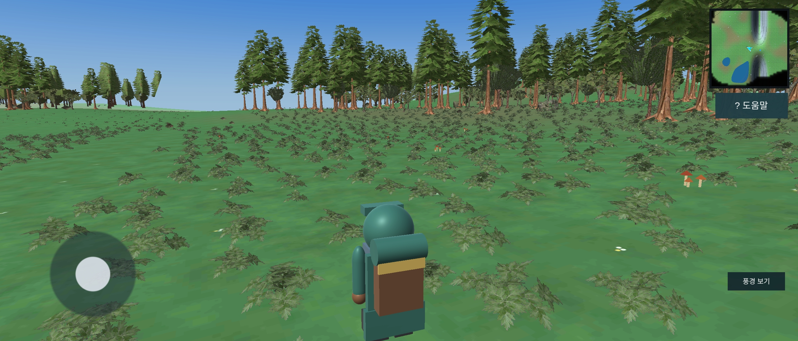
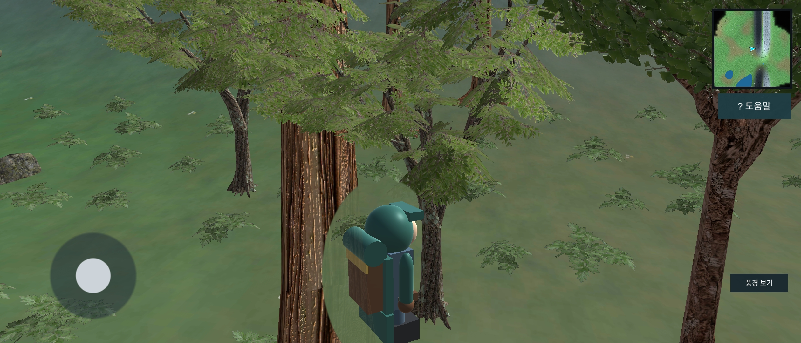
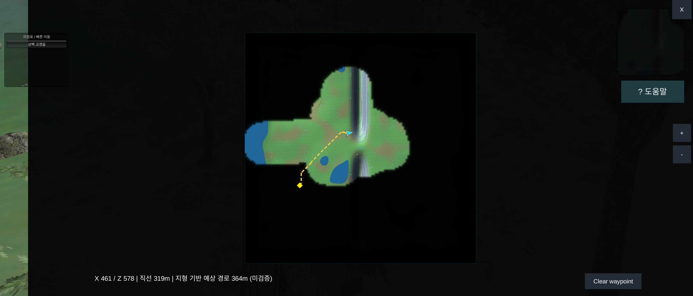
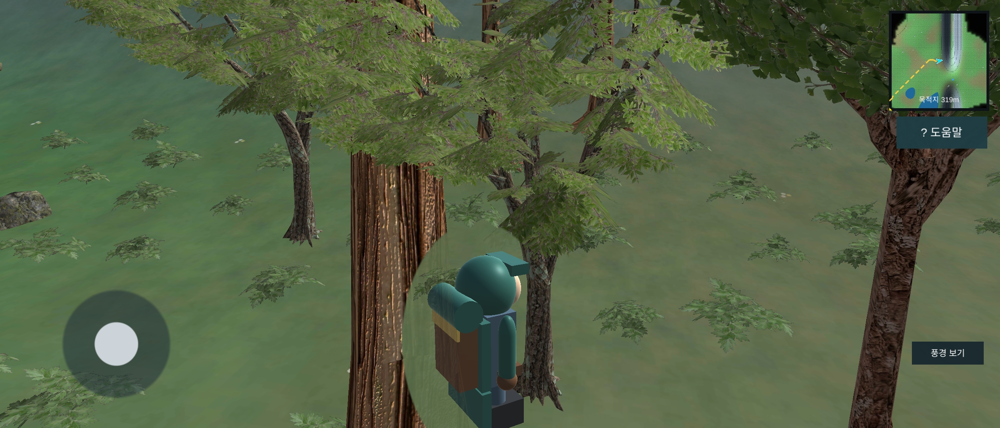

# MapSliceStreaming

**Unity 6.3 LTS · URP · Android · Open World Streaming & Rendering Optimization**

Unity 기반의 모바일 오픈 월드 기술 데모입니다. 대규모 Terrain을 청크 단위로 관리하고, 실제 자연 에셋의 LOD 및 원거리 표현, 식생 렌더링, 캐릭터 가림 셰이더, 월드맵과 목적지 안내 기능을 구현했습니다.

## 개발 동기

최근 **《더 위쳐 3: 와일드 헌트》의 리마스터 버전**을 플레이하면서 넓은 필드를 탐험할 때 자연스럽게 이어지는 지형과 숲의 표현에 관심을 갖게 되었습니다.

특히 먼 거리의 숲이 유지되는 방식, 캐릭터 이동에 따른 환경 전환, 탐험을 지원하는 월드맵 시스템에서 영감을 받았습니다.

이를 단순한 게임 재현이 아닌, 모바일 환경에서 구현할 수 있는 **월드 스트리밍 및 렌더링 최적화 기술 포트폴리오**로 발전시켰습니다.

*본 프로젝트는 개인 기술 데모이며, 위쳐 3의 원본 코드나 게임 리소스를 사용하지 않았습니다.*

## 주요 기술

| 기술               | 구현 내용                    |
| ---------------- | ------------------------ |
| World Streaming  | Terrain 청크의 동적 로딩 및 언로딩  |
| Addressables     | 청크 리소스 참조와 로딩 생명주기 관리    |
| Vegetation LOD   | 실제 나무 에셋 기반 5단계 LOD      |
| Distant Forest   | 미로드 청크를 위한 원거리 숲 렌더링     |
| GPU Instancing   | 반복 식생과 원거리 나무의 렌더링 최적화   |
| Occlusion Shader | 캐릭터를 가리는 나무 영역의 국소적 처리   |
| World Navigation | 미니맵, 전체 지도, 목적지와 경로 표시   |
| Editor Tools     | 에셋 검사, 설정 적용, 백업 및 복구 도구 |

## Android 실제 구동 화면

### 원거리 숲과 필드 전경

### 실제 나무와 캐릭터 가림 처리

### 전체 지도

### 목적지와 경로 표시

## 핵심 설계

### 1. 청크 기반 월드 스트리밍

플레이어 위치를 기준으로 필요한 Terrain 청크를 관리합니다. 동적 로딩과 언로딩을 분리하고, 반복 이동 시 불필요한 리소스 재생성과 메모리 사용을 줄이는 구조를 목표로 설계했습니다.

### 2. 실사형 자연 에셋과 5-Level LOD

Japanese Cypress, Sawtooth Oak, Ginkgo 등 실제 자연 모델을 활용했습니다.

가까운 거리에서는 원본 고품질 메시를 사용하고, 멀리 있는 나무에는 단계적으로 낮은 상세도를 적용합니다. Unity의 화면 상대 크기 기반 LOD 전환 기준을 활용해 품질과 렌더링 비용 사이의 균형을 조정했습니다.

### 3. 스트리밍 경계의 원거리 숲 표현

초기에는 로드되지 않은 청크의 나무를 단순 삼각형 프록시로 표현했으나, 청크 로딩 시 외형이 갑자기 달라지는 문제가 발생했습니다.

이를 개선하기 위해 실제 나무의 저해상도 LOD 메시를 원거리 대체 표현에 재사용하는 구조를 적용했습니다.

### 4. 캐릭터 가림 셰이더

캐릭터가 나무 뒤에 위치할 때 시야가 가려지는 문제를 개선하기 위해 화면상 가림 영역을 계산하는 셰이더를 구현했습니다.

알파 블렌딩과 클리핑 기법을 활용하며, 나무 LOD 전환과 캐릭터 가림 처리는 독립적인 시스템으로 구성했습니다.

### 5. 미니맵과 전체 지도

탐험 중 플레이어 위치를 확인할 수 있는 미니맵과 전체 지도를 구성했습니다. 지도에서 목적지를 설정하고 직선거리 및 지형 기반 예상 경로를 확인할 수 있습니다.

## Android 데모

APK는 GitHub Releases에서 제공할 예정입니다.

## 개발 환경

- Unity 6000.3.24f1
- Universal Render Pipeline
- C#
- HLSL / ShaderLab
- Addressables
- Android

## 공개 범위

이 저장소에는 기술 검토가 가능한 핵심 구현 코드, 셰이더, 설계 문서와 실제 실행 화면을 공개합니다.

Unity Asset Store에서 제공된 원본 FBX, 텍스처, 머티리얼 등의 에셋은 별도의 라이선스에 따라 관리하며 공개 소스 저장소에 포함하지 않습니다.

## 개발 과정에서 얻은 경험

이 프로젝트는 단순히 맵을 표시하는 데서 끝나지 않고, 원거리 나무 팝핑, LOD 전환, 셰이더 가림 오류, 에셋 의존성, 모바일 렌더링 품질 문제를 반복적으로 분석하고 개선하는 과정이었습니다.

**기능 구현뿐 아니라 문제 재현, 원인 분석, 수정, 검증 도구와 최종 빌드까지 이어지는 개발 과정**을 보여주는 것을 목표로 합니다.